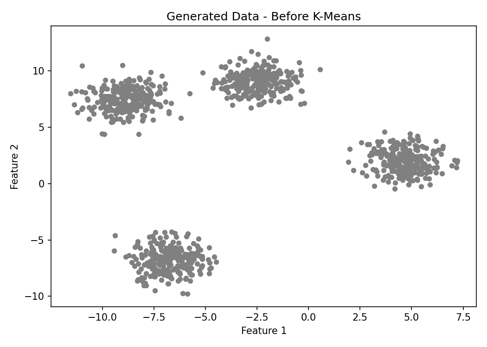
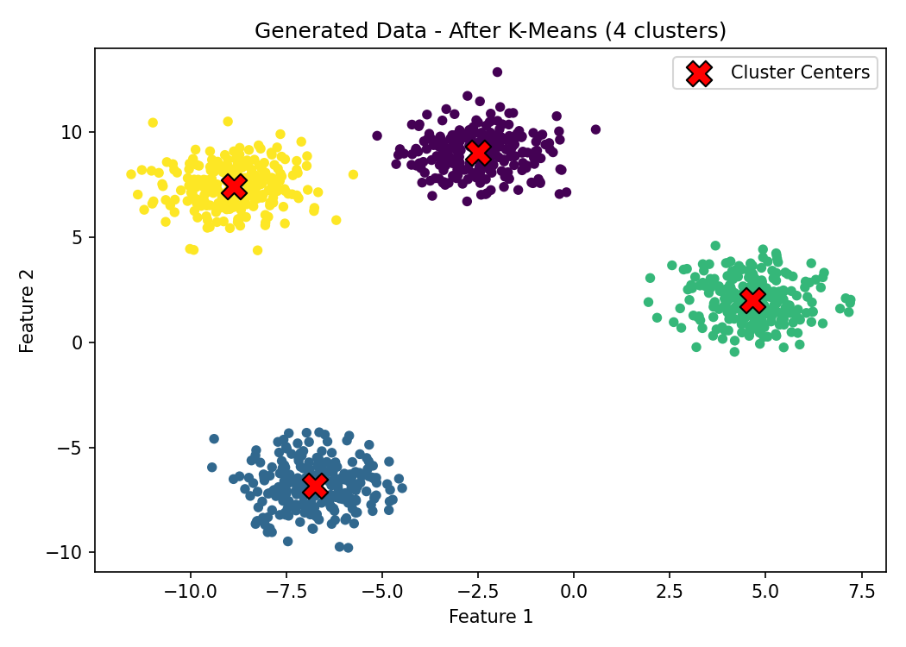
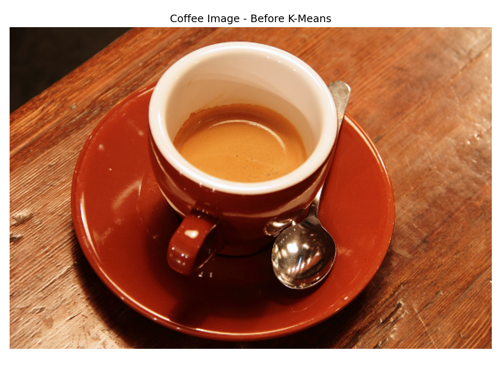
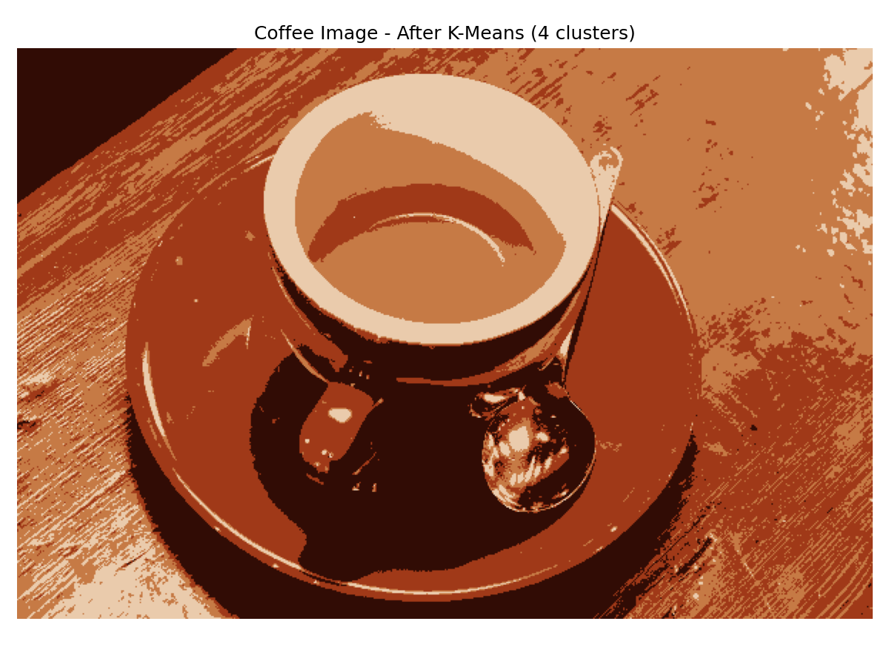

# BSCS4388-Lab1-KMeans
Computer Vision Lab 1 - K-Means Clustering
# BSCS 4388 – Computer Vision
## Lab 1: Image Clustering – K-Means

### Overview
This lab applies the K-Means clustering algorithm to generated data and a real-world image using Python.

### Objectives
- Generate 1,000 data points with four clusters using `make_blobs`.
- Apply K-Means clustering with four clusters.
- Visualize the data before and after clustering.
- Segment the colors of the coffee image using K-Means.

### Technologies Used
- Python 3
- NumPy
- Matplotlib
- Scikit-learn
- Scikit-image

### Files
- `kmeans_clustering.py` – Python implementation of K-Means clustering.
- `kmeans_data_before.png` – Generated data before clustering.
- `kmeans_data_after.png` – Generated data after clustering.
- `kmeans_image_before.png` – Coffee image before clustering.
- `kmeans_image_after.png` – Coffee image after clustering.

### Installation
Install the required libraries:

```bash
pip install numpy matplotlib scikit-learn scikit-image
```

### How to Run
```bash
python kmeans_clustering.py
```

 ### Results

#### 1. Generated Data — Before K-Means


#### 2. Generated Data — After K-Means


#### 3. Coffee Image — Before K-Means


#### 4. Coffee Image — After K-Means



